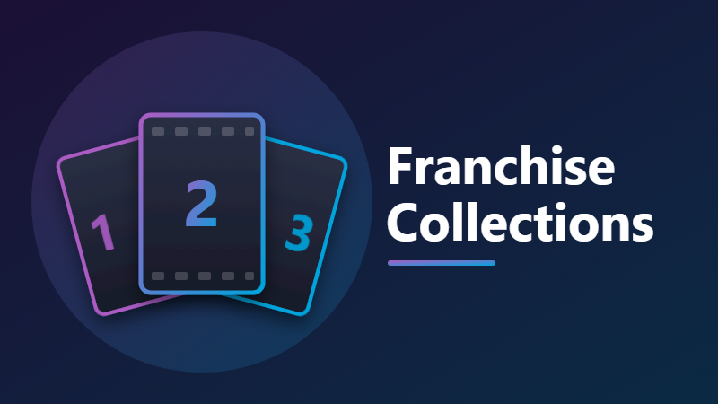

# Franchise Collections for Jellyfin
n

Automatically creates and maintains movie franchise collections, e.g. *The Matrix Collection* or *Shrek Collection*,
using the franchise ("collection") data that Jellyfin's built-in TMDb metadata provider already stores on each movie.

| Jellyfin server | Package |
|---|---|
| 12.x | `franchise-collections_<version>_jellyfin-12.zip` |
| 10.11.x | `franchise-collections_<version>_jellyfin-10.11.zip` |

## How it works

- Movies are grouped by their TMDb collection ID. Once you own at least *N* movies from a franchise (default 2), a collection is created, and Jellyfin then fetches its poster and overview from TMDb.
- Existing collections are reused instead of duplicated: first by TMDb ID, then by an exact name match (that also covers collections made by Jellyfin's own "Automatically add to collection" library option).
- Updates happen:
  - about 2 minutes after movies are added or their metadata changes, so a whole library scan triggers one sync, and
  - daily at 4 AM (**Dashboard → Scheduled Tasks → Library → Sync franchise collections**), and
  - whenever you click **Sync now** on the plugin's settings page.
- Movies you added to a collection by hand are never removed. With "Remove stale movies" turned on, a movie is removed only when TMDb now lists it under a *different* franchise.

## Build

Requires the .NET 9 and .NET 10 SDKs.

```powershell
.\package.ps1
```

The zips are written to `artifacts\`.

## Install

### From the plugin repository (recommended)

1. In Jellyfin, go to **Dashboard → Plugins → Repositories** (in 10.11: **Catalog → ⚙ Settings**) and add a repository:
   - Name: `Franchise Collections`
   - URL: `https://raw.githubusercontent.com/TNT24/jellyfin-plugin-franchise-collections/main/manifest.json`
2. Install **Franchise Collections** from the catalog. Jellyfin picks the build that matches your server version.
3. Restart Jellyfin. Go to **Dashboard → Plugins → Franchise Collections** to change settings, then click **Sync now**.

### Manually

1. Stop Jellyfin.
2. Copy the ready-made folder for your server version, `artifacts\jellyfin-12\Franchise Collections_1.0.0.0`
   or `artifacts\jellyfin-10.11\Franchise Collections_1.0.0.0`, into the server's plugin directory:
   - Windows: `%ProgramData%\Jellyfin\Server\plugins`
   - Linux: `/var/lib/jellyfin/plugins`
   - Docker: `/config/plugins`
3. (Or create a `Franchise Collections_1.0.0.0` folder there yourself and extract the matching zip into it.)
4. Start Jellyfin. Go to **Dashboard → Plugins → Franchise Collections** to change settings, then click **Sync now**.

Your movie libraries must use the TMDb metadata downloader (the default). If a movie isn't being picked up, refresh its metadata
so it gets its TMDb collection ID.
